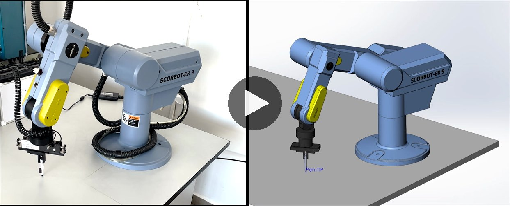
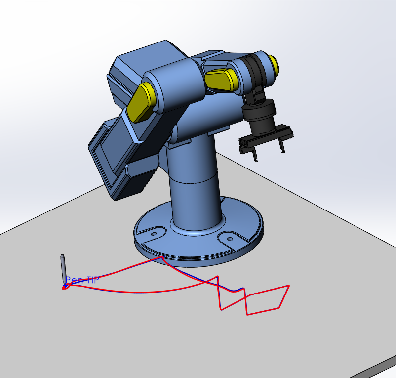
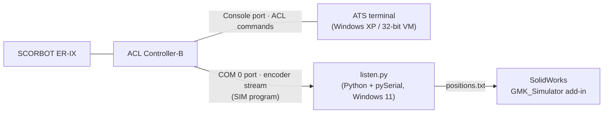

# Digital Twin of the SCORBOT ER-IX — Bachelor's Thesis

**Programming and Simulation of the Five-Degree-of-Freedom Robot SCORBOT ER-IX**

📄 **[Read the thesis (PDF)](Thesis.pdf)** · 📊 **[Defense presentation (PPTX)](Defense_Presentation.pptx)** · 🎬 **[Demo video](https://youtu.be/ACNnW8LuZ_g)**

> The thesis text is written in Bulgarian.

[](https://youtu.be/ACNnW8LuZ_g)

*Left: the real robot. Right: the SolidWorks model driven in real time by the robot's encoder readings. Click to watch on YouTube.*

## Abstract

This thesis builds a **one-way, real-time link between a physical SCORBOT ER-IX educational robot and its 3D model in SolidWorks**. The model then works as a digital twin. The thesis also **measures how closely the model reproduces the real machine**.

A background ACL program (`SIM`) running on the ACL Controller-B streams the five joint encoder values and the gripper state over a dedicated serial port. A Python program (`listen.py`) receives this stream, converts encoder counts to joint angles and keeps a pose file up to date. The SolidWorks add-in GMK_Simulator reads that file and moves the robot assembly.

The key architectural decision is to **split the command and measurement traffic across two independent serial channels** of the controller. This lets the closed ATS programming environment and the custom listener run at the same time.

Four experiments of increasing complexity compare **three sources**: the real robot, the controller and the model. Comparing three sources instead of two lets the total error be split into a kinematic, a calibration and a mounting component.

## Results

| # | What was tested | Measure | Result |
|---|---|---|---|
| 1 | Joint space | Joint angle, controller vs. model | < 0.001° |
| 2 | Positional accuracy | Deviation \|Δ\| | 1.15 mm vs. controller; 7.36 mm vs. the table |
| 3 | Path accuracy (linear moves) | Straightness δ | 0.48 … 0.85 % over ~110 mm |
| 4 | Point-to-point program with gripper | Contour shape | Matches; corners round off at high speed |

The ~7 mm error against the table comes from how the robot is mounted on the table, not from the robot or the software chain. It is systematic and can be removed by calibrating the work cell. The model also reproduces dynamic errors: the path drawn in SolidWorks shows the same corner rounding as the contour the robot draws with the pen.

<p align="center">
  
</p>

The thesis also documents a diagnostic procedure for the **`HOME FAILURE` / `IMPACT PROTECTION`** fault on Controller-B. The root cause turned out to be a depleted backup battery: when it fails, the controller wipes its configuration and falls back to zeroed homing parameters. The axes themselves were fine.

## System architecture



## Repository contents

| Path | Description |
|---|---|
| [`Thesis.pdf`](Thesis.pdf) | Full thesis (Bulgarian, 82 pages) |
| [`Defense_Presentation.pptx`](Defense_Presentation.pptx) | Slides used at the thesis defense |
| [`programs/SIM.dnl`](programs/SIM.dnl) | ACL background program that streams encoders `ENC[1..5]` and gripper output `OUT[1]` over COM 0 every 50 ms |
| [`programs/listen.py`](programs/listen.py) | Python listener: reads the COM 0 stream, converts encoder counts to 1/100°, updates `positions.txt` in place |
| [`programs/pen.dnl`](programs/pen.dnl) | ACL demo program `pen10`: picks up a pen and writes a contour with linear `SPLINED` |
| [`Model/`](Model) | SolidWorks assembly of the robot (`Scorbot_ER-IX.SLDASM`) with links, gripper and pen |
| [`video/`](video) | Demo videos (720p) |
| [`docs/`](docs) | List of the manufacturer manuals used (not redistributed) |

## Running it

**Requirements:** SCORBOT ER-IX with ACL Controller-B (firmware F2.28). ATS on 32-bit Windows (Windows XP, or a VirtualBox VM with the serial port passed through as a Host Device), connected to the controller's **Console** port. A second PC with Python 3 and SolidWorks + the GMK_Simulator add-in, connected to the controller's **COM 0** port through an RS-232–USB adapter.

1. Download `SIM.dnl` to the controller through ATS and start it in the background (`RUN SIM`).
2. Install the dependency and set `PORT` in `listen.py` to the USB-serial port connected to COM 0:

   ```bash
   pip install -r programs/requirements.txt
   python programs/listen.py
   ```

3. Point GMK_Simulator at the generated `positions.txt`. The model now follows the robot.

The link runs at 9600 baud, 8N1. If the stream stalls after an XOFF, clear it from ATS with `DO CLRCOM 0`.

> GMK_Simulator is a third-party SolidWorks add-in and is not part of this repository.
